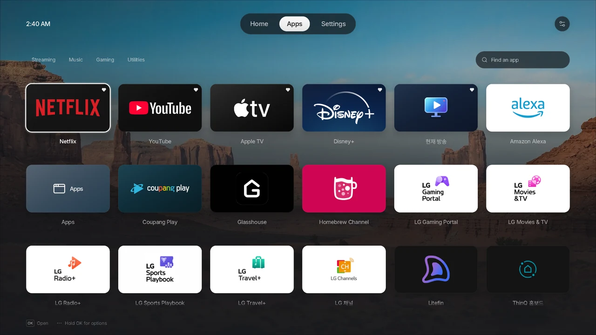
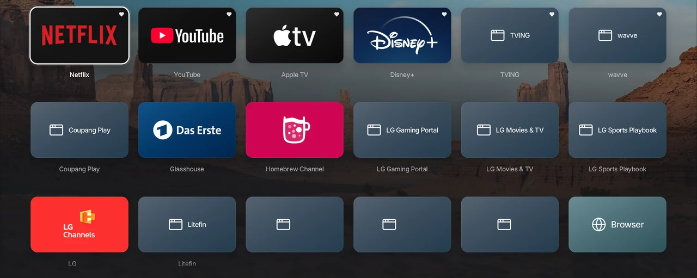
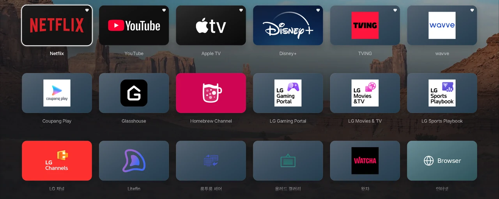
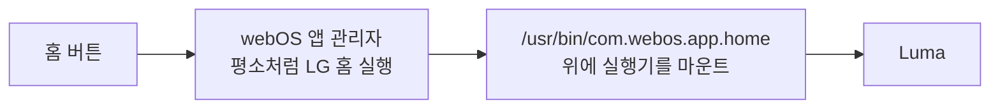

# Luma

루팅한 LG webOS TV에서 쓰는 네이티브 런처예요. 애플 TV에서 영감을 받았어요.

[English](readme.md) | 한국어

## 이 포크에 대해

webOS 6을 쓰는 LG C1용 포크예요. 원본 `main` 위에 **webOS 6에서 Luma를 홈으로 쓰는 기능**을 더했어요. 원본의 홈 교체 기능은 webOS 6을 지원하지 않거든요 ([동작 방식](#webos-6에서-luma를-홈으로-쓰기)). 원본에 합쳐질 때까지 아이콘 수정 두 가지도 같이 들어 있어요.

- Litefin처럼 로고가 가장자리까지 닿는 투명 아이콘이 같은 색 카드에 묻히지 않고 어두운 카드에 보여요 ([#35](https://github.com/ecklf/lg-luma/pull/35)).
- 아이콘을 읽는 대로 바로 보여 줘서, 앱 화면이 3배쯤 빨리 채워져요 ([#36](https://github.com/ecklf/lg-luma/pull/36)).



제 LG C1(webOS 6.5.3)에서 홈으로 쓰는 Luma를 TV에서 바로 캡처했어요.

**다운로드:** [Luma 2.2.0 preview 2](https://github.com/wonjoonSeol/lg-luma/releases/tag/v2.2.0-preview.2).
IPK 파일을 [webOS Dev Manager](https://github.com/webosbrew/dev-manager-desktop)나
[영어 README의 SSH 방법](readme.md#ssh)으로 설치하면 돼요. 빌드 도구는 필요 없어요.

### Luma에 합쳐진 수정

이 포크에서 시작한 수정이에요. 하나하나 모두 원본 `main`에 합쳐졌고, [v2.1.0](https://github.com/ecklf/lg-luma/releases/tag/v2.1.0)으로 출시됐어요.

- **한글 앱 이름**이 빈칸 대신 보여요 ([#22](https://github.com/ecklf/lg-luma/pull/22), [`14b18f8`](https://github.com/ecklf/lg-luma/commit/14b18f8)에서 합쳐짐).
- **한국 OTT와 LG 앱 아이콘** ([#18](https://github.com/ecklf/lg-luma/pull/18), [`3e256f6`](https://github.com/ecklf/lg-luma/commit/3e256f6)에서 합쳐짐). [#26](https://github.com/ecklf/lg-luma/pull/26)부터는 Luma가 모든 앱 아이콘을 TV에서 바로 읽어 와요.
- **올바른 로고.** Glasshouse에 더 이상 Das Erste 로고가 붙지 않아요 ([#21](https://github.com/ecklf/lg-luma/pull/21), [`27802ac`](https://github.com/ecklf/lg-luma/commit/27802ac)에서 합쳐짐).

[#35](https://github.com/ecklf/lg-luma/pull/35)와 [#36](https://github.com/ecklf/lg-luma/pull/36)은 아직 원본에서 검토 중이라, 합쳐질 때까지 이 포크의 preview에 들어 있어요.

**수정 전: Luma 2.0.3**



**수정 후: 세 가지 수정 적용**



두 화면 모두 제 TV에 있는 같은 앱을 Luma의 데스크톱 미리보기로 그렸어요.

### webOS 6에서 Luma를 홈으로 쓰기

원본의 홈 교체 기능은 webOS 10과 11에서만 돌아가요. webOS 6에서는 버전 확인에서 멈추고, 앱 관리자에
LG 홈을 다시 불러오는 기능도 없어요. 대신 webOS 6의 LG 홈은 프로그램 파일 하나라서, `home6.sh`가 그 파일
위에 작은 실행기를 마운트해요. 앱 관리자는 평소처럼 LG 홈을 실행하고, 실제로는 Luma가 떠요. LG 홈 파일은
그대로 남아요.



preview를 설치하고 Luma를 한 번 열어서 잘 되는지 확인한 다음, TV의 root SSH 셸에서 실행하세요.

```sh
sh /media/developer/apps/usr/palm/applications/com.ecklf.luma/home6.sh enable
```

상태를 보거나 끄려면:

```sh
sh /var/lib/luma-home6/home6.sh status
sh /var/lib/luma-home6/home6.sh disable
```

켜기 전에 읽어 주세요.

- TV 한 대에서 테스트했어요: LG OLED48C1KNB, webOS 6.5.3.
- 전원을 완전히 껐다 켜면, 부팅 훅이 홈을 Luma로 바꿀 때까지 2분쯤 LG 홈이 보여요.
- Luma가 홈일 때 앱을 열면 LG 이용 약관 동의 창이 뜰 수 있어요.
- Luma 자동 실행 훅을 먼저 끄고(`autostart.sh disable`), Luma를 지우기 전에는 `home6.sh`를 꺼 주세요.

자세한 내용은
[개발 가이드(영어)](https://github.com/wonjoonSeol/lg-luma/blob/webos6-home/development.md#webos-6-home-integration)에
있고, 소스는 [`webos6-home` 브랜치](https://github.com/wonjoonSeol/lg-luma/tree/webos6-home)에 있어요.

나머지 설치와 개발 문서는 [영어 README](readme.md)를 봐 주세요.
